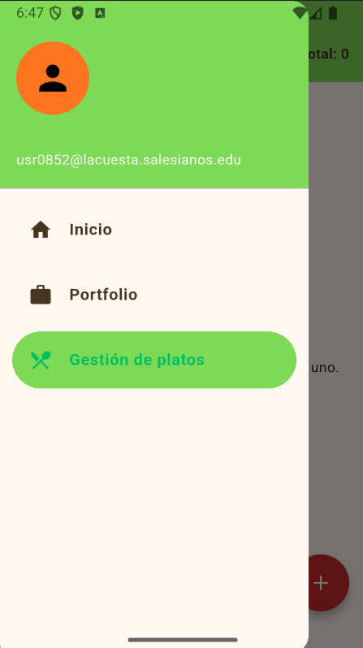
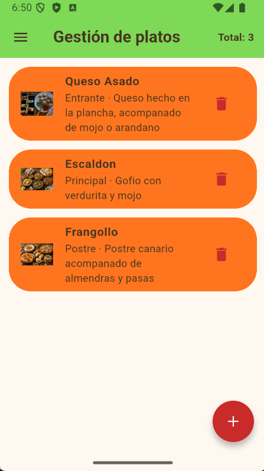
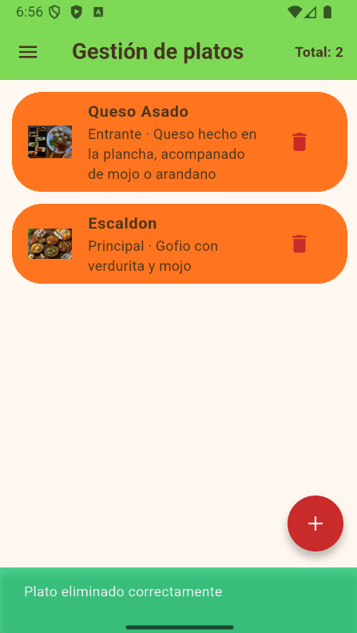

PGL-P2-MyPortfolio

App Flutter de gastronomía canaria (Sabores Canarias), desarrollada por tareas.

Tarea 3: Pantalla CRUD de platos

Rama: P2-Tarea3-Formulario

Funcionalidades
- Pantalla Gestión de platos accesible desde el Drawer (ruta /crud).
- Lista dinámica de platos.
- Botón + que abre un modal (AlertDialog) para añadir un plato:
- Nombre (obligatorio)
- Descripción breve (máx. 60 caracteres)
- Categoría (Entrante, Principal, Postre)
- Imagen al lado de cada plato según su categoría.
- Botón de borrar en cada plato, con aviso (SnackBar).
- Marcador con el total de platos en la barra superior.

Capturas de lo hecho:

Drawer:
 

Management:
 

Delete:
 