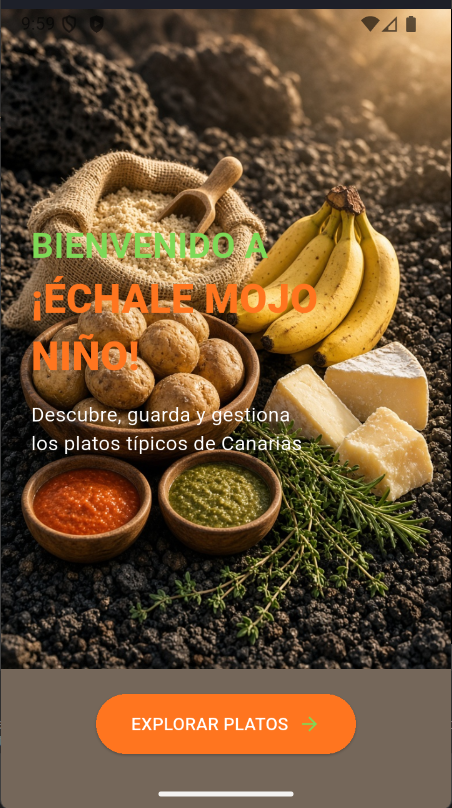
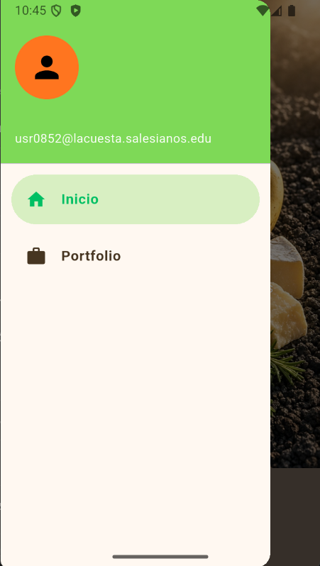
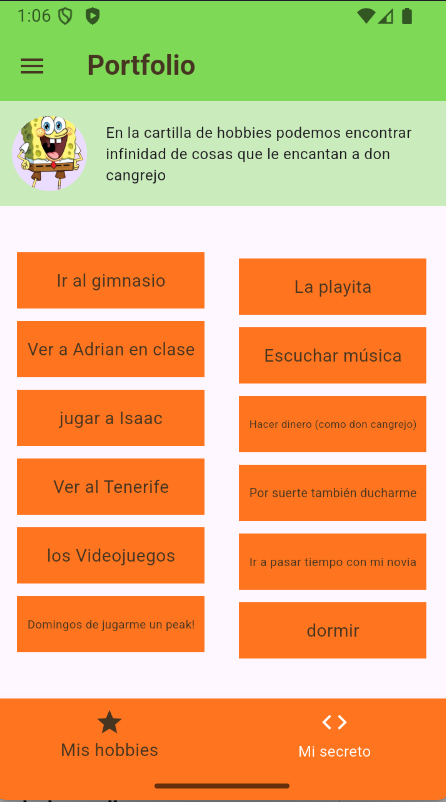

# PGL-P2-MyPortfolio

App Flutter "¡Échale mojo niño!" sobre gastronomía canaria. Tarea 1: navegación.

## Qué incluye

- Navegación con **Drawer** y **go_router** (Inicio y Portfolio).
- Pantalla de **bienvenida**, según el diseño de la tarea anterior y además portfolio de la primera página hecha.
- Pantalla de **Portfolio**, adaptada a la paleta del nuevo diseño, es decir, los colores.

## Estructura

lib/
├── main.dart
├── app_router.dart
└── widgets/ (drawer, welcome, portfolio y sus componentes)

## Capturas

| Bienvenida | Drawer |
|---|---|
|  |  |

| Portfolio: hobbies | Portfolio: secreto |
|---|---|
|  |  |

