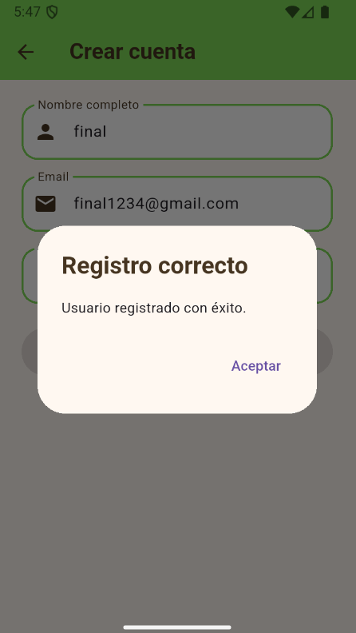
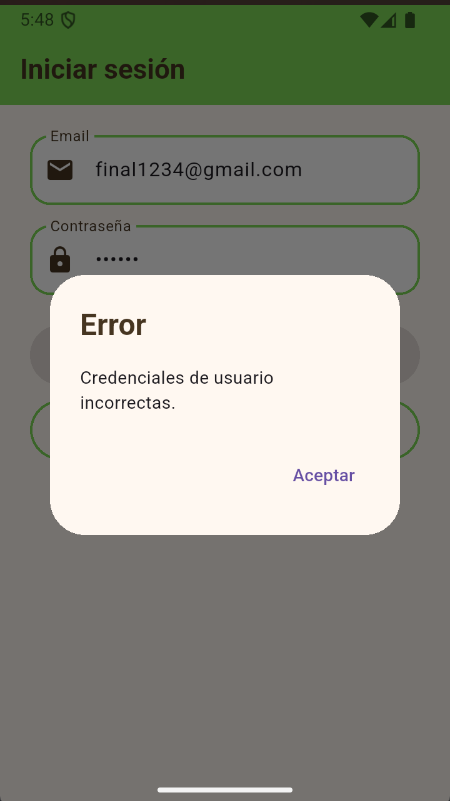
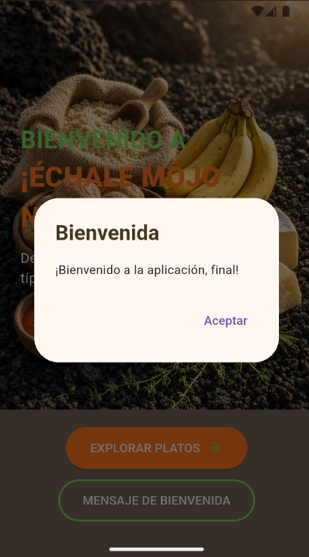

# PGL-P2-MyPortfolio

App Flutter "¡Échale mojo niño!" sobre gastronomía canaria.

## Tarea 5: Sesión de usuario

Rama: `P2-Tarea5-SesionUsuario`

Registro e inicio de sesión de usuarios con la API del profesor
(`https://my-users-api.onrender.com`), que autentica con tokens JWT.

### Funcionalidades

- **Registro:** nombre completo, email y contraseña. Se valida el nombre, el email y que la contraseña sea segura (8+ caracteres con mayúscula, minúscula y número). Muestra la respuesta de la API en una alerta y, si sale bien, redirige al login.
- **Inicio de sesión:** email y contraseña, con un botón para ir al registro. Muestra la respuesta de la API en una alerta.
- **Token seguro:** al iniciar sesión, el token se guarda en el almacenamiento interno del dispositivo con `flutter_secure_storage`.
- **Arranque de la app:** solo se muestra el login (sin Drawer). Si hay un token guardado, se comprueba en la API (`/users/check-token`) y, si es válido, se pasa directamente a Bienvenida.
- **Cerrar sesión:** botón en el Drawer que borra el token y vuelve al login.
- **Bienvenida:** botón que muestra en una alerta el mensaje del endpoint `/users/welcome`, enviando el token en la cabecera `Authorization: Bearer`.

### Estructura

```
lib/
├── main.dart
├── app_router.dart
├── exceptions/      Excepciones propias (una por código HTTP: 400, 401, 404, 409, 500)
├── models/          User y LoginResponse (fromJson / toJson)
├── services/
│   ├── http_service.dart    Peticiones HTTP genéricas y gestión de errores
│   ├── auth_service.dart    Registro, login, comprobar token, cerrar sesión y bienvenida
│   └── token_storage.dart   Guardado seguro del token
└── widgets/         Pantallas (login, registro, bienvenida...) y componentes
```

Las peticiones HTTP están encapsuladas en los servicios: las pantallas solo llaman a
`AuthService` y muestran el resultado.

### Nota sobre la API

La API está alojada en Render: si pasa 15 minutos sin tráfico entra en reposo y la
primera petición tarda 50-60 segundos. Además, la base de datos es efímera, así que
los usuarios registrados se pierden cuando la API se reinicia.

### Capturas

**Registro exitoso**



**Login fallido**



**Login exitoso**


**Mensaje de bienvenida (botón de la pantalla Bienvenida)**

